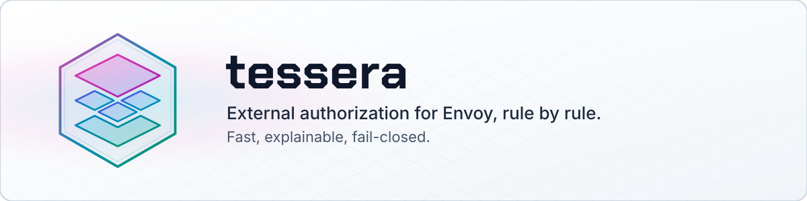

  <picture>
    <source media="(prefers-color-scheme: dark)" srcset="docs/public/banner-dark.svg">
    <source media="(prefers-color-scheme: light)" srcset="docs/public/banner-light.svg">
    
  </picture>

 

**tessera** will be an external authorization service for [Envoy](https://www.envoyproxy.io/).

## Status

tessera is in development and has no release yet. The binary has only the `help` and `version` commands.

## Development

You need Go, at the version in [`go.mod`](go.mod), and a C compiler for the race detector. Inside a Git work tree, `make check` checks formatting and modules, runs `go vet` and the tests with the race detector, and builds the binary; `make build` builds `bin/tessera`. `make ci` adds the vulnerability scan, the workflow lint, and the build and checks of the documentation, as CI does.

See [CONTRIBUTING.md](CONTRIBUTING.md) for the requirements, the checks, the documentation rules and the format of pull request titles, and [RELEASING.md](RELEASING.md) for the release process.

## Documentation

The documentation sources are in [`docs/`](docs/), as a site built with [VitePress](https://vitepress.dev/). To preview it, run `make docs-install` once, then `make docs-dev`, or `make docs-build` followed by `make docs-preview` for the production build. `make docs-build` needs Node.js at the version in [`docs/.node-version`](docs/.node-version), and `make docs-check` also needs Google Chrome.

## License

tessera is released under the [Apache License 2.0](LICENSE). The copyright notice is in [NOTICE](NOTICE).
