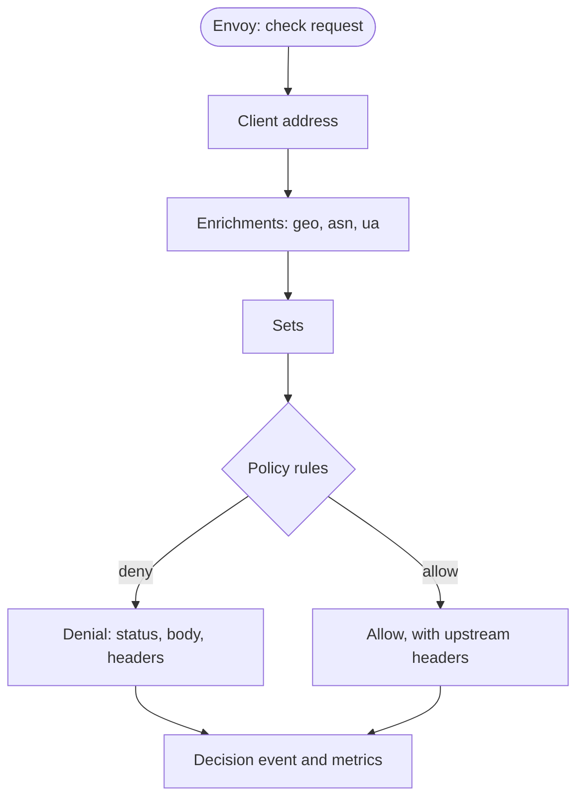

# How tessera works

This page explains how **tessera** decides a request: the steps that a request goes through, from Envoy's check to the response and the record of the decision, and how tessera is built around them, with decisions that read memory only while the data they read is loaded and refreshed in the background. Each step links to the guide that sets it up and to the reference that lists its values.

## The path of a request

Envoy asks tessera about each HTTP request, and tessera answers with a decision. The diagram follows a request through the steps of tessera, each with a guide of its own.

Each step can use what the steps above it give: an enrichment describes the client address or the client software, a set can be looked up with the client address or with an enrichment, as in `sets.hosting.contains(asn.number)`, and a rule reads all of them. tessera does not run the steps one after the other, though: it reads the client address with the request, and an enrichment or a set only when an expression reads it (see [What a decision reads](#what-a-decision-reads)).

### Envoy asks

Envoy's `ext_authz` filter calls tessera for each HTTP request, before Envoy sends it on, with the host, method, path, scheme and headers of the request, and the address of the connection that Envoy received it on. Expressions read the request as the attributes `request.*` (see [Attributes](../reference/expressions.md#attributes)). The [gRPC API reference](../reference/grpc-api.md#authorization-service) describes the call, and [What Envoy needs](../reference/grpc-api.md#what-envoy-needs) the settings of the filter.

### Client address

tessera reads the address of the client from the one source that [`client_ip`](../reference/configuration.md#client-ip) declares: the connection, the `X-Forwarded-For` header, or a header that a proxy sets. Expressions read it as `client.ip`. A request whose source gives no address has no client address, and every condition whose result depends on it counts against allowing. [Set the client address](./client-address.md) helps you choose the source.

### Enrichments

An enrichment is a group of attributes that tessera derives from the request, and that every expression can read. tessera has three, which [`enrichment`](../reference/configuration.md#enrichment) configures. Two describe the client address: `geo`, where the address is, from its country to its coordinates, and `asn`, its autonomous system, which tessera reads from files in the MaxMind DB format. The third, `ua`, describes the client software, from the `user-agent` header of the request, without a file: its browser, its operating system, the kind of device, and whether it is a bot. [Enrich requests](./enrichments.md) shows how to get the files, keep them up to date and use the enrichments; [`geo`](../reference/expressions.md#geo), [`asn`](../reference/expressions.md#asn) and [`ua`](../reference/expressions.md#ua) list the attributes.

### Sets

A set is a named list of networks, autonomous system numbers, strings or geographic areas, declared in [`sets`](../reference/configuration.md#sets) with its values or a file, that a condition looks a value up in with `sets.<name>.contains(value)`. Sets keep the lists that change on their own, such as a block list, apart from the rules. [Use sets](./sets.md) shows how to declare and update them, and [Sets](../reference/expressions.md#sets) in the expression language reference how `contains` reads them.

### Policy rules

The rules of [`policy`](../reference/configuration.md#policy) decide. tessera evaluates them in order, and the first whose condition is true decides with its action, `allow` or `deny`; a request that no rule decides gets the default action. A condition is an expression of the [expression language](../reference/expressions.md) on the request, the client address, the enrichments and the sets. [Write policy rules](./policy-rules.md) shows how to order the rules, handle missing data and try them before you enforce them.

### Response

For a denial, tessera gives Envoy the status, the body and the headers that the client gets. For an allowed request, it gives Envoy the upstream headers, which replace or remove the headers of the same names that the client sent, on the request that Envoy sends on. With [`policy.mode: audit`](../reference/configuration.md#policy-mode), tessera reports a denial without enforcing it, and Envoy sends the request on, with the upstream headers. [Shape responses and logs](./responses-and-logs.md) shows how to choose both, and the [gRPC API reference](../reference/grpc-api.md#authorization-service) describes what tessera sends.

### Decision event and metrics

Every decision counts in the [metrics of the decisions](../reference/metrics.md#decisions), which the admin listener serves at `/metrics`. The decisions that [`log.decisions`](../reference/configuration.md#log-decisions) selects also write a [`decision`](../reference/logs.md#decision) event, with the fields of [`log.decision_fields`](../reference/configuration.md#log-decision-fields). [Log the decisions](./responses-and-logs.md#log-the-decisions) shows how to choose them.

## How tessera is built

### One process, two listeners

[`tessera serve`](../reference/cli.md#tessera-serve) is one process with two listeners. The gRPC listener, at [`server.listen`](../reference/configuration.md#server-listen), answers Envoy's checks and the gRPC health checks (see the [gRPC API reference](../reference/grpc-api.md)). The admin listener, at [`admin.listen`](../reference/configuration.md#admin-listen), serves `/livez`, `/readyz` and `/metrics` (see [Admin endpoints](../reference/admin-endpoints.md)). Neither has authentication: let only Envoy reach the first, and only your probes and Prometheus the second.

### A decision reads memory only

tessera loads the sets and the files of the enrichments into memory before it opens its listeners (see [Startup](../reference/cli.md#startup)), and from then on a decision reads only what tessera holds in memory: it touches no disk and no network, and never waits for standard output. The work that needs files or standard output runs in the background:

| On the request path, for each decision | In the background |
| --- | --- |
| Read the request and its client address, then evaluate the rules in order, with the enrichments and the sets that they read. | Check the file of each set and of each database of the enrichments every `refresh`, and replace the copy in memory when the file has new valid content. |
| Compute the upstream headers of a request that Envoy sends on. | Make a set read from a file unavailable once its copy is older than its [`max_staleness`](../reference/configuration.md#sets-name-max-staleness), and available again at its next successful check. |
| Count the decision in the metrics, queue its `decision` event with its decision fields when tessera writes one, and answer Envoy. | Write the queued `decision` events to standard output, and the reports of the conditions that could not be evaluated. |

A `decision` event that does not fit its queue is dropped and counted, rather than slowing a decision (see [The queue of decision events](../reference/logs.md#the-queue-of-decision-events)). The probes of the admin listener read memory only, and nothing that the admin listener does is on the path of a decision (see [Fixed limits](../reference/admin-endpoints.md#fixed-limits)).

### The configuration is read once, the data refreshes

tessera reads its configuration file once, when it starts, and checks all of it before it opens a socket: every key, every expression, every set and every file of an enrichment. An error stops it with exit status 2 before it serves anything (see [Startup](../reference/cli.md#startup)). The configuration does not change while tessera runs: a change to the file takes effect when tessera starts again.

The data that the configuration points to changes without a restart. tessera checks the file of each set every [`sets.<name>.refresh`](../reference/configuration.md#sets-name-refresh) and the file of each database of the enrichments every [`enrichment.geo.refresh`](../reference/configuration.md#enrichment-geo-refresh) or [`enrichment.asn.refresh`](../reference/configuration.md#enrichment-asn-refresh). A file with new valid content replaces the copy in use, atomically. A file that is missing or invalid does not: tessera keeps the copy it has, and a set read from a file becomes unavailable only once its copy is older than its `max_staleness`. The [failure modes](../reference/failure-modes.md) list what happens in each case, and the events and metrics of each load show it as it happens.

### What a decision reads

Each decision reads one consistent state. Every expression of a decision, whether a condition, an upstream header or a decision field, reads the same request and the same copies of the sets and of the databases of the enrichments: those in use when the decision started. A copy replaced meanwhile serves the next decisions (see [Sets](../reference/expressions.md#sets) in the expression language reference).

tessera computes an enrichment only when an expression reads it, at the first read in a decision, and every later read in the same decision reuses the result: it looks the client address up in a database for `geo` and `asn`, and analyzes the `user-agent` header for `ua`. A request that a rule decides before any expression reads them computes nothing (see [When tessera computes an enrichment](../reference/expressions.md#when-tessera-computes-an-enrichment)). The records of recent `user-agent` headers stay in a cache of limited size that every decision shares, and a header found there is not analyzed again (see [`enrichment.user_agent.cache_entries`](../reference/configuration.md#enrichment-user-agent-cache-entries)).

### Failures close

When tessera cannot evaluate a condition, because the client address is missing, a header is absent, a set is unavailable or a record cannot be read, the condition counts against allowing: a `deny` rule denies, and an `allow` rule does not match. Missing data can make tessera deny a request that it would have allowed with the data, and never allow a request that it would have denied, unless the configuration says otherwise for that data, as [`sets.<name>.on_unavailable`](../reference/configuration.md#sets-name-on-unavailable) does for a set. [Conditions that cannot be evaluated](./policy-rules.md#conditions-that-cannot-be-evaluated) shows how to write rules with this in mind, and the [failure modes](../reference/failure-modes.md) list every case.

When Envoy gets no decision, because tessera is unreachable, too slow or fails the call, Envoy decides as its `failure_mode_allow` says: set it to `false`, as [What Envoy needs](../reference/grpc-api.md#what-envoy-needs) shows.

### See what tessera decides

- [`tessera eval`](../reference/cli.md#tessera-eval) shows how the policy decides a request that you describe, without Envoy: the attributes that the rules read, the outcome of each rule, the decision and the upstream headers.
- [`tessera config validate`](../reference/cli.md#tessera-config-validate) checks a configuration, its sets and the files of its enrichments, without starting anything.
- While tessera runs, the [`decision`](../reference/logs.md#decision) events and the [metrics](../reference/metrics.md) record what it decides, and the [log events](../reference/logs.md#events) and metrics of the sets and of the enrichments record each load of their files.
