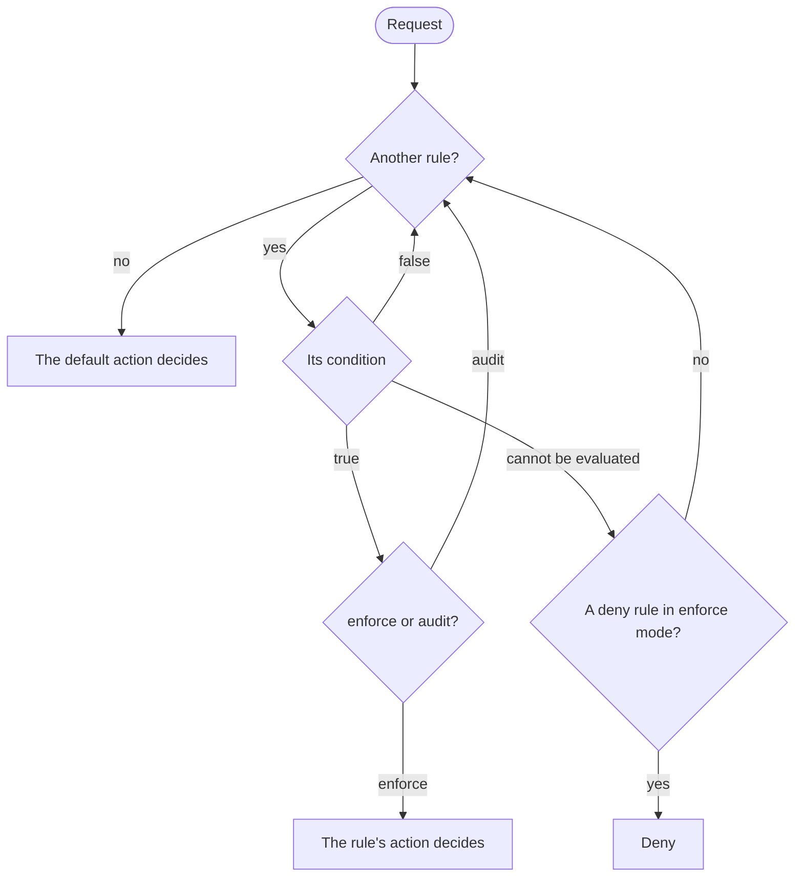

# Write rules

**tessera** decides each request with the rules of [`policy.rules`](../reference/configuration.md#policy-rules), whose conditions are written in the [expression language](../reference/expressions.md). This page explains how tessera applies the rules, how to order them, how to handle data that is missing, how to try rules before you enforce them, and how to choose what Envoy answers a denied client.

## How tessera decides

tessera evaluates the rules in the order in which the file lists them. The first rule whose condition is true decides, with its action, and tessera evaluates no further rule. A request that no rule decides gets [`policy.default_action`](../reference/configuration.md#policy-default-action).

The flowchart shows what tessera does with each rule.



## Order the rules

Write the rules from the most specific to the most general, and let the default action describe what is left. A common order:

1. The denials that nothing may override, such as networks blocked during an incident.
2. The exceptions that allow, such as the office network on the admin pages.
3. The denials of whole areas, such as the admin pages for everyone else.
4. The allows of the public parts.
5. `policy.default_action: deny` for everything else.

```yaml [config.yaml]
client_ip:
  from: x_forwarded_for
  trusted_hops: 1

policy:
  default_action: deny
  rules:
    - name: blocked-networks
      description: Networks blocked during an incident.
      action: deny
      when: client.ip.inCidr("198.51.100.0/24") || client.ip.inCidr("2001:db8:bad::/48")
    - name: admin-from-office
      action: allow
      when: request.path.startsWith("/admin") && client.ip.inCidr("203.0.113.0/24")
    - name: admin
      action: deny
      when: request.path.startsWith("/admin")
    - name: public-site
      action: allow
      when: request.host == "www.example.com" && request.method in ["GET", "HEAD"]
```

A rule without `when` matches every request, so it can only be the last rule: tessera rejects a configuration with rules after it, which would never be evaluated. [`docs/examples/rules.yaml`](#a-complete-example) is a complete configuration with more rules.

## Conditions that cannot be evaluated

A condition is indeterminate when its evaluation fails and its result depends on the failure: for example, it reads `client.ip` and the request has no client address, or it reads `request.headers["x-api-key"]` and the request has no such header. [Indeterminate conditions](../reference/expressions.md#indeterminate-conditions) lists the causes.

tessera counts an indeterminate condition against allowing:

- a `deny` rule denies, because tessera cannot rule out that it would have denied: a rule that blocks keeps blocking when its data is missing;
- an `allow` rule does not match, and tessera evaluates the next rule, because it cannot claim that the rule would have allowed. If a later rule allows anyway, the allow is certain; if it denies, the denial is the cautious choice.

Missing data can then make tessera deny a request that it would have allowed with the data, and never allow a request that it would have denied. In `blocked-networks` above, a request without a client address is denied. Each such condition counts in [`tessera_rule_evaluation_errors_total`](../reference/metrics.md#tessera-rule-evaluation-errors-total) and shows in [`evaluation_error`](../reference/logs.md#evaluation-error) events; a decision that it changed has `reason=error` or `indeterminate_rules` in its [`decision`](../reference/logs.md#decision) event.

To keep a condition from depending on data that can be missing, test it first: `"x-api-key" in request.headers && request.headers["x-api-key"].startsWith("k-")` is `false`, not indeterminate, without the header.

## Handle a missing client address

A request has no client address when the source that [`client_ip`](../reference/configuration.md#client-ip) declares gives none. Every rule that reads `client.ip` then counts against allowing. To decide such requests yourself, put a rule that tests `has(client.ip)` before the rules that read the address.

To answer them with a response of their own:

```yaml [config.yaml]
policy:
  default_action: deny
  rules:
    - name: no-client-address
      action: deny
      when: "!has(client.ip)"
      response:
        status: 400
        body: No client address.
    - name: office
      action: allow
      when: client.ip.inCidr("203.0.113.0/24")
```

To allow some of them, such as the health checks of a load balancer that connects without `X-Forwarded-For`:

```yaml [config.yaml]
policy:
  default_action: deny
  rules:
    - name: health-checks
      action: allow
      when: '!has(client.ip) && request.path == "/healthz"'
    - name: office
      action: allow
      when: client.ip.inCidr("203.0.113.0/24")
```

A rule like `health-checks` allows requests because data is missing: write it only for requests that you would allow from any client.

::: tip Quote a condition that starts with `!`
YAML reads a value that starts with `!` as a tag. Quote such a condition, as above, or write it in a literal block (`|`).
:::

## Audit a rule

A rule with `mode: audit` is evaluated like the others, but never decides: when its condition is true, tessera reports the match and evaluates the next rule. A rule in audit mode that matches every request does not make the rules after it unreachable.

```yaml [config.yaml]
policy:
  default_action: allow
  rules:
    - name: scanners
      action: deny
      mode: audit
      when: '"user-agent" in request.headers && request.headers["user-agent"].matches("(?i)(sqlmap|nikto)")'
```

The matches show in `audit_rules` of the [`decision`](../reference/logs.md#decision) event, which the default [`log.decisions: deny`](../reference/configuration.md#log-decisions) writes for an allowed request when a rule in audit mode with `action: deny` matched, and in [`tessera_audit_matches_total`](../reference/metrics.md#tessera-audit-matches-total). When the rule does what you expect, remove `mode: audit`.

## Audit a policy

With [`policy.mode: audit`](../reference/configuration.md#policy-mode), tessera allows every request, while it decides each one with the rules as it would in `enforce` mode. Use it to install tessera in front of an application, or to change a whole policy, without denying a request. The denials that it would have applied show with `enforced=false` in the [`decision`](../reference/logs.md#decision) events and in [`tessera_decisions_total`](../reference/metrics.md#tessera-decisions-total).

```yaml [config.yaml]
policy:
  mode: audit
  default_action: deny
  rules:
    - name: office
      action: allow
      when: client.ip.inCidr("203.0.113.0/24")
```

## Choose what Envoy answers

A denied client gets the status, body and headers of [`policy.deny_response`](../reference/configuration.md#policy-deny-response), `403` without a body by default. A `deny` rule can have a [`response`](../reference/configuration.md#policy-rules-response) of its own, whose keys replace those of `policy.deny_response`:

```yaml [config.yaml]
policy:
  default_action: deny
  deny_response:
    body: '{"error": "forbidden"}'
    headers:
      content-type: application/json
  rules:
    - name: admin
      action: deny
      when: request.path.startsWith("/admin") && !client.ip.inCidr("203.0.113.0/24")
      response:
        status: 404
        body: '{"error": "not found"}'
```

A request denied by `admin` gets `404`, the body `{"error": "not found"}` and the header `content-type: application/json`; any other denied request gets `403` and the body `{"error": "forbidden"}`.

## Try a request

[`tessera eval`](../reference/cli.md#tessera-eval) shows how the policy decides a request that you describe, rule by rule, without Envoy:

```sh
tessera eval --config config.yaml --ip 203.0.113.7 --host www.example.com --path /admin/users
```

## Check the configuration

`tessera config validate` compiles every condition, without starting anything:

```sh
tessera config validate --config config.yaml
```

An unknown attribute, a wrong type or a rule that hides the rules after it stops it with status 2, at its position in the file:

```text
tessera: policy.rules[1].when (line 12, column 33): undefined field 'hots'
```

## A complete example

`docs/examples/rules.yaml` combines the rules of this page:

<<< @/examples/rules.yaml{yaml}
